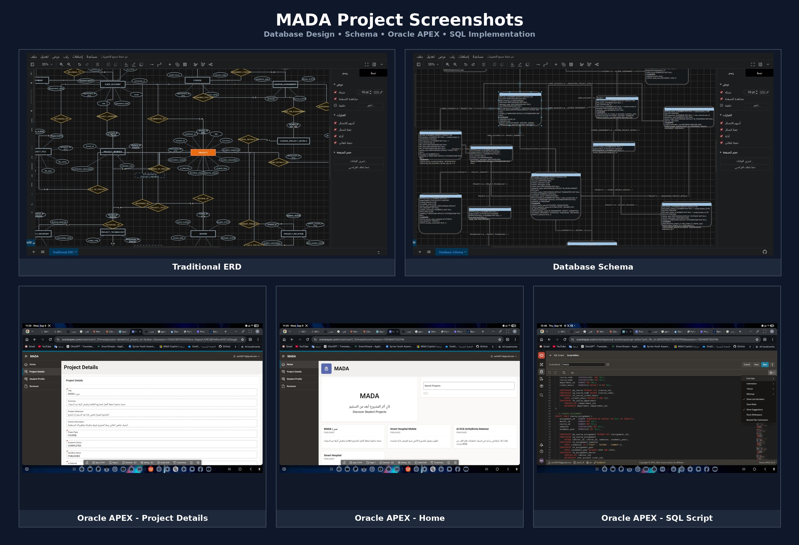

# MADA | مدى

  <b>University Student Project Knowledge Platform</b>

  <i>لأن أثر المشروع أبعد من التسليم</i>

  <b>Database Design • Oracle Database • Oracle APEX</b>

---

## 💡 About MADA

**MADA | مدى** is a university knowledge platform designed to preserve, organize, and showcase distinguished student projects.

Instead of allowing valuable projects to disappear after submission or graduation, MADA transforms them into a structured and searchable knowledge repository that future students can explore, learn from, and continue developing.

---

## 🎯 The Problem

Many valuable university projects lose their impact after completion because:

- Projects are stored in scattered files and archives.
- Previous projects are difficult to discover.
- Valuable ideas may be repeated instead of improved.
- Student contributions can be forgotten after graduation.
- There is no clear way to track the evolution of projects across years.

---

## ✅ The Solution

MADA provides an organized academic workflow:

<pre>
Student Project
      ↓
Doctor Nomination
      ↓
Project Documentation
      ↓
Academic Review
      ↓
Approval
      ↓
Publication
      ↓
Future Continuation
</pre>

The platform preserves selected projects and makes their knowledge available for future students.

---

## 🗄️ Database Design

The database is the core of the MADA system.

It was designed using an **ERD-driven architecture** and implemented using **Oracle Database**.

### Key Facts

| Item | Details |
|---|---|
| Database | Oracle Database |
| Total Tables | 14 |
| Central Entity | PROJECT |
| Design | ERD + Relational Schema |
| Query Language | SQL |
| Functional Prototype | Oracle APEX |
| Relationships | 1:1 • 1:N • M:N • Self-Referencing |

---

## 🧩 Main Database Tables

MADA contains **14 interconnected tables**:

| Table | Purpose |
|---|---|
| `DEPARTMENT` | University departments |
| `USER_ACCOUNT` | Students, doctors and admins |
| `COURSE` | Academic courses |
| `COURSE_ASSIGNMENT` | Doctor-course assignments |
| `PROJECT` | Main project information |
| `COURSE_PROJECT_DETAILS` | Course project details |
| `GRADUATION_PROJECT_DETAILS` | Graduation project details |
| `PROJECT_MEMBER` | Students participating in projects |
| `TECHNOLOGY` | Technologies used |
| `PROJECT_TECHNOLOGY` | Connects projects and technologies |
| `PROJECT_FILE` | Project files and links |
| `PROJECT_PASSPORT` | Current project status and future ideas |
| `REVIEW` | Academic review history |
| `PROJECT_RELATION` | Relationships between projects |

---

## 🔗 Important Relationships

### Students and Projects

<pre>
USER_ACCOUNT
      ↕
PROJECT_MEMBER
      ↕
   PROJECT
</pre>

`PROJECT_MEMBER` resolves the many-to-many relationship between students and projects.

### Projects and Technologies

<pre>
PROJECT
   ↕
PROJECT_TECHNOLOGY
   ↕
TECHNOLOGY
</pre>

`PROJECT_TECHNOLOGY` connects every project with the technologies used to build it.

---

## 🔄 Knowledge Continuity

One of MADA's key features is the ability to connect new projects with previous projects using `PROJECT_RELATION`.

Supported relationships include:

- `EXTENDS`
- `CONTINUATION`
- `INSPIRED_BY`

Example:

<pre>
2025
Smart Hospital System
        ↓
2026
Smart Hospital Mobile Application
        ↓
2027
Assistant Medical AI
</pre>

This allows future students to continue previous work while preserving the history and contributions of earlier teams.

---

## 🛡️ Data Integrity

The Oracle Database implementation uses:

- `PRIMARY KEY`
- `FOREIGN KEY`
- `NOT NULL`
- `UNIQUE`
- `CHECK`
- `DEFAULT`
- `IDENTITY`
- `ON DELETE CASCADE`
- Composite Keys

These constraints help maintain reliable and consistent data.

---

## 💻 Technologies Used

| Technology | Purpose |
|---|---|
| Oracle Database | Database implementation |
| Oracle APEX | Functional web prototype |
| SQL | Tables, relationships, constraints and queries |
| Draw.io / diagrams.net | ERD and Schema design |
| GitHub | Source code and project documentation |

---

## 🌐 Oracle APEX Prototype

A functional database-driven prototype was implemented using **Oracle APEX**.

The prototype includes:

- 🏠 Home / Project Catalog
- 🔎 Search Projects
- 📄 Project Details
- 👤 Student Profile
- 📝 Reviewer Page

The prototype demonstrates how the database structure can operate inside a real web application.

---

## 📸 Project Preview

  

The preview includes:

**Traditional ERD • Database Schema • SQL Implementation • Oracle APEX Home • Project Details**

---

## 🚀 Future Development

Future versions of MADA may include:

- 📱 Mobile Application
- 🤖 AI Project Recommendation System
- 🐙 GitHub Integration
- 🌳 Project Evolution Tree
- 📊 Analytics Dashboard
- 🏫 University System Integration

---

## 👩‍💻 Development Team

**🏛️ University of Science and Technology**

Faculty of Computing and Information Technology  
Department of Software Engineering

**Developed by:**

- **Sarah Alnobi — XZero**
- **Marwa Jameel**
- **Samira Al-Tabi**

📅 **2026**

---

## ✨ Our Vision

  <b>
  MADA does not only preserve project files. 
  It preserves knowledge, people, technologies, 
  and the evolution of ideas across generations.
  </b>

  <b>MADA | مدى</b> 
  لأن أثر المشروع أبعد من التسليم

---
